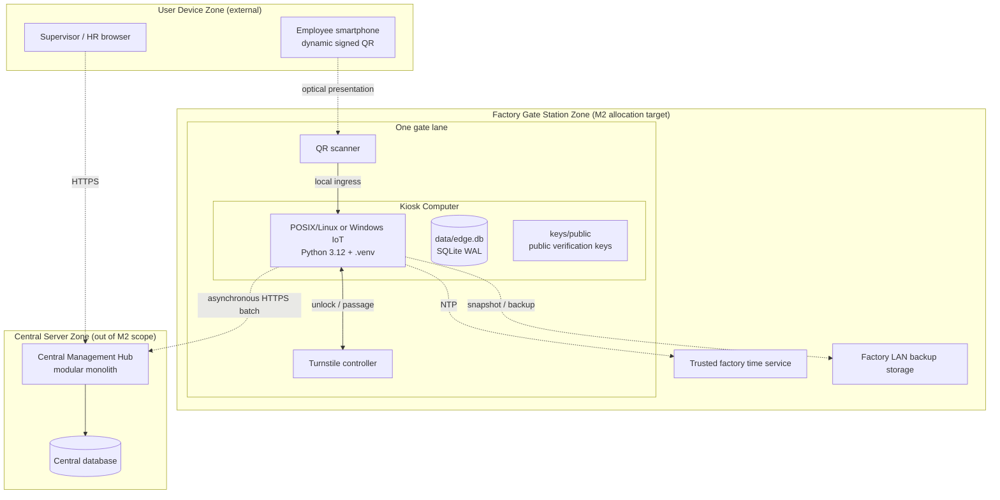

# Allocation View

| Metadata | Value |
|---|---|
| System | TMC QR-Based Attendance & Access Control System |
| Module | Edge Gate Access Processing (`tmc_access`) |
| Milestone | M2 |
| Owner | Nguyen Tran Tuan Khai |
| Course | Software Architecture (CO3017), HCMUT |
| Baseline | Assignment 1 §4.1 and Figure 5; ADR-001..004 |
| Related views | [`module-view.md`](module-view.md), [`component-connector-view.md`](component-connector-view.md) |
| Related contracts | [`../contracts/edge-access-contracts.md`](../contracts/edge-access-contracts.md) |
| Status | Target allocation; kiosk packaging and backup automation are not implemented in the scaffold |

## 1. Purpose and deployment boundary

The Allocation View maps software elements from the Module and C&C Views to
physical nodes, operating-system environments, local storage, and network
boundaries. M2 allocates the Edge Gate Access Processing runtime to the
**Factory Gate Station Zone**. It does not allocate or implement the Central
Management Hub, the employee/user-device applications, proprietary turnstile
protocols, or HR/Payroll integration.

Assignment 1 defines three physical zones:

1. **Factory Gate Station Zone (M2 target):** one kiosk computer per gate lane
   at the Binh Duong and Long An factories, connected to a QR scanner and an
   existing turnstile controller. The factory LAN also provides trusted time
   and backup-storage interfaces.
2. **Central Server Zone (external):** the Hub application server and database
   server. The Hub is the central system of record and provides the
   asynchronous ingestion boundary used by the Edge.
3. **User Device Zone (external):** employee phones displaying dynamic signed
   QR credentials and desktop/browser clients used by supervisors or HR.

The physical topology is a design baseline, not a claim that these nodes are
provisioned by this repository.



### Diagram Legend

- **Outer subgraph box:** Physical deployment zone or location boundary.
- **Inner rectangular node:** Physical computing device or hardware controller.
- **Cylinder / inner box:** Durable file on local disk or execution runtime.
- **Solid line:** Local physical hardware or OS bus connection, such as USB,
  serial, GPIO, or LAN.
- **Dashed line:** Network transport across physical zones or optical
  presentation.

## 2. Physical node and execution-environment catalog

| Zone | Node | Hardware / operating environment | Allocated software or data | Allocation status |
|---|---|---|---|---|
| Factory Gate Station | Kiosk Computer | Gate-side workstation; POSIX/Linux or Windows IoT is permitted by the scaffold assumptions. Python 3.12 virtual environment. | `tmc_access` package, FastAPI/Uvicorn boundary, access coordinator, QR/policy components, SQLite repositories, turnstile adapter, and sync service; local SQLite database and public-key cache. | M2 target; exact hardware, OS image, service account, and service manager are unspecified. |
| Factory Gate Station | QR Scanner | Optical scanner connected by a deployment-selected USB-HID, serial, or LAN interface. | Scanner firmware and scan envelope source. | External peripheral; exact medium is unconfirmed by A1. |
| Factory Gate Station | Turnstile Controller | Existing industrial controller and passage sensors. | Vendor adapter boundary; deterministic mock is used for tests. | External peripheral; vendor protocol is OD-13. |
| Factory Gate Station | Trusted Time Service | Factory LAN NTP server. | Clock synchronization source for credential time checks. | External service; exact host and NTP policy are not configured here. |
| Factory Gate Station | Backup Storage | Factory LAN storage node. | Database snapshots or other approved kiosk backups. | A1 deployment target; no backup client or schedule exists in the scaffold. |
| Central Server | Hub application server | Cloud or enterprise data-center host. | Modular Monolith Hub, QR issuance, policy distribution, ingestion APIs, reporting, and payroll integration. | External and out of M2 scope. |
| Central Server | Hub database server | Central database host. | Central attendance, identity, and audit data. | External and out of M2 scope. |
| User Device | Employee smartphone | Mobile device. | Dynamic QR presentation; QR issuance/signing is outside the Edge module. | External and out of M2 scope. |
| User Device | Supervisor/HR computer | Desktop or browser-capable device. | Hub web client. | External and out of M2 scope. |
| External | HR/Payroll system | Existing enterprise system. | Scheduled Hub-side integration. | External and out of M2 scope. |

## 3. Operating-system and process execution model

### 3.1 Kiosk hosting

The target host runs Python 3.12 from a virtual environment. The repository
currently starts the API with an ASGI server and factory command:

```text
uvicorn tmc_access.config.container:create_default_app --factory
```

The ASGI process hosts the FastAPI health and scan boundary. A completed
implementation allocates the following C&C components within that process:

| Runtime allocation | Hosted elements | Execution model |
|---|---|---|
| ASGI server | Uvicorn and FastAPI `presentation/api` | Owns socket handling and dispatches requests according to Uvicorn/ASGI configuration. Worker count and process model are not fixed by this repository. |
| Foreground access path | `AccessCoordinator` and injected domain ports/adapters | Synchronous application call for one scan. QR validation, policy evaluation, Phase 1 persistence, and the bounded unlock call execute on the request-handling execution context. |
| Background synchronization | `SyncService`, outbox repository, and `SyncClient` | Periodic background task or daemon thread. The exact scheduler is not specified; it must not block or become a synchronous WAN dependency of the access path. |
| Local durable state | SQLite WAL database and public-key/policy snapshots | File-backed state shared by foreground and background activities through repository ports, not direct cross-thread object mutation. |

The current scaffold exposes the API boundary and composition root, but the
coordinator, repositories, sync service, and QR/policy business flows remain
unimplemented. Therefore the table describes the intended hosting allocation,
not a verified production process graph.

### 3.2 Concurrency and synchronization

The foreground access path and background sync worker coordinate through the
file-backed SQLite repositories. SQLite is configured for WAL,
`synchronous=NORMAL`, foreign keys, and `busy_timeout=5000`; WAL permits
readers and writers to make progress under SQLite's locking rules, but it does
not guarantee sub-millisecond locks or unlimited throughput. If a persistence
operation exceeds the access-path budget or fails, the coordinator must fail
closed and must not unlock.

No specific systemd unit, Windows service, Docker container, supervisor, or
other service manager is mandated. Packaging and restart policy are
deployment decisions and must not be inferred from the Python module layout.

## 4. Local file-system and storage allocation

`Settings` defines relative defaults for the SQLite file, Hub URL, and public
key directory. A deployment may resolve these paths below an application root
such as `/opt/tmc_access`, but that root and the service account are not
specified by the repository.

```text
<kiosk application root>/
├── .env                       # local settings; deployment secret material
├── data/
│   ├── edge.db                # file-backed SQLite database
│   ├── edge.db-wal            # SQLite WAL while active
│   └── edge.db-shm            # SQLite WAL shared-memory index while active
├── keys/
│   └── public/                # cached public verification keys only
└── logs/                      # deployment-managed diagnostic logs, if enabled
    └── edge-service.log      # raw QR payloads must never be logged
```

| Artifact | Repository setting or use | Allocation and protection rule |
|---|---|---|
| `.env` | `SettingsConfigDict(env_file=".env")`; contains station/factory identity, paths, and operational settings. | Keep readable only by the service account (for example, mode `0600` on POSIX). Never commit a real `.env` or credentials. |
| `data/edge.db` | `TMC_SQLITE_PATH`, default `data/edge.db`. | Must be file-backed; in-memory SQLite is rejected because WAL requires shared disk-backed state. Restrict database access to the service account and approved backup process. |
| `edge.db-wal`, `edge.db-shm` | SQLite-managed sidecar files created when WAL is active. | Do not copy or delete independently while SQLite is running; include them through a consistent database snapshot procedure. |
| `keys/public/` | `TMC_QR_PUBLIC_KEY_DIR`, default `keys/public`. | Contains public verification keys only. Private signing keys never belong on the kiosk. Public key files may be readable by the service, but the directory must be protected from unauthorized replacement. |
| `logs/` | No log path is currently configured in `Settings`. | A deployment may provide rotated diagnostic logs. Redact raw QR payloads and minimize identifiers; retention and rotation are deployment requirements. |

The database stores audit and attendance data required by the contracts, but
raw QR payloads are secret-like and must not be persisted. The local storage
schema and sequence details remain OD-11.

## 5. Network topology and communication paths

The following matrix distinguishes repository contracts from deployment
assumptions. Exact scanner wiring, vendor transport, backup schedule, and Hub
authentication are not implemented by this repository.

| Source | Target | Physical medium / protocol | Scope and timing | Security / failure semantics |
|---|---|---|---|---|
| Employee smartphone | QR scanner | Optical presentation of dynamic QR | Physical gate-lane interaction; scanner capture is allocated within the scan budget. | Payload is passed to the kiosk for local validation; raw payload is never logged. |
| QR scanner | Kiosk Computer | USB-HID, RS-232/USB serial, or LAN are possible deployment choices; A1 does not select one. | Local gate station; envelope parsing target ≤30 ms, hard parsing fallback 100 ms. | Malformed or oversized input is rejected; framing and device buffering are deployment-specific. |
| Kiosk Computer | Turnstile Controller | Vendor API over LAN, serial/RS-485, or another local industrial interface; OD-13. | Local gate station; unlock timeout 800 ms; passage monitoring window 15 seconds. | `GateAdapter` separates unlock acknowledgement from passage. Controller rejection, timeout, or unavailability fails closed. |
| Kiosk Computer | Trusted Time Service | NTP, conventionally UDP 123, over the factory LAN. | Periodic clock synchronization; credential checks use the configured clock-skew policy. | Host, authentication, and clock service placement are external deployment concerns. |
| Kiosk Computer | Factory backup storage | A1 proposes SFTP/LAN; exact implementation is not present. | Background snapshot/backup traffic, isolated from the scan-to-unlock path. | Backup authentication and consistency protocol must be defined by deployment; it cannot expose QR payloads or private keys. |
| Kiosk Computer | Central Management Hub | HTTPS/TLS over the enterprise WAN; endpoint default is a placeholder. | Asynchronous batch synchronization; WAN latency never blocks access authorization. | At-least-once delivery, accepted-ID acknowledgement, and retry for 429/503. mTLS versus application authentication is OD-10. |
| Central Management Hub | Kiosk local snapshots | Policy/public-key distribution mechanism is deferred (OD-09). | Asynchronous/deferred; no synchronous gate-path dependency. | Only locally available snapshots are used until a distribution connector is adopted. |
| Supervisor/HR browser | Central Management Hub | HTTPS, external to M2. | Hub administration/reporting path. | Not part of kiosk authorization or synchronization. |

## 6. Storage sizing, failure, backup, and recovery allocation

### 6.1 Local capacity and operational thresholds

Assignment 1 describes a sizing target for continuous offline buffering and
audit retention. The repository does not currently enforce a queue capacity,
disk monitor, or automatic gate lockout policy, so these values are deployment
requirements rather than verified implementation behavior:

- Size local storage for the A1 target of seven days of unsynchronized events
  plus 30 days of retained audit history.
- A1 estimates that seven days of buffering is below 500 MB at the stated
  factory workload; validate this estimate against the finalized OD-11 schema
  and payload sizes.
- Warn at 70% disk utilization and raise a critical alert at 85%.
- Never silently drop FIFO outbox records or report synchronization success
  when storage is full. The response to a critical condition (operator
  intervention, quarantine, or gate lockout) requires an operational decision.

### 6.2 Backup and recovery target

The Assignment 1 target is a consistent local-database snapshot to factory LAN
backup storage every five minutes, giving an RPO of at most five minutes. This
repository has no backup scheduler, SFTP client, snapshot verifier, or RPO test,
so the target must not be presented as an implemented guarantee.

For a total kiosk disk or motherboard failure, the target recovery allocation
is:

1. Provision a replacement kiosk with the approved OS image and Python 3.12
   runtime.
2. Restore the latest verified database snapshot and approved public-key cache.
3. Reapply `.env` settings and service-account permissions without copying
   private keys or real secrets from source control.
4. Start the kiosk runtime and allow `SyncService` to resume pending delivery.

The five-minute RPO and any recovery-time objective depend on backup
automation, restore verification, and deployment runbooks that are outside
the current scaffold. SQLite WAL sidecars must be handled through a
SQLite-consistent snapshot procedure, not copied independently while active.

## 7. Deployment invariants and open decisions

- The Edge access path must remain local and must not require a synchronous Hub
  round trip.
- The SQLite database must be file-backed and configured for WAL; in-memory
  SQLite is not a valid kiosk allocation.
- Kiosks contain public verification keys only. QR signing private keys remain
  outside the Edge.
- Raw QR payloads must not appear in logs, backups, or persistent domain
  records.
- `AccessAttempt`, unlock acknowledgement, passage confirmation,
  `AttendanceRecord`, and synchronization acknowledgement remain distinct
  lifecycle stages.
- **OD-10:** Edge-to-Hub authentication and the final ingestion transport
  remain undecided; this view specifies only the HTTPS `SyncClient` boundary.
- **OD-13:** the vendor turnstile protocol remains unspecified; the mock
  adapter is the deterministic test allocation.
- **OD-09:** policy/key snapshot distribution remains unspecified.
- **OD-11:** local schema, sequence details, capacity enforcement, and backup
  policy require finalization.
- No service manager, container image, kiosk installer, OS hardening profile,
  or exact hardware specification is adopted by this repository.

## 8. Traceability and implementation status

The Kiosk Computer allocation corresponds to the runtime components in the
[C&C View](component-connector-view.md) and the ports/adapters in the
[Module View](module-view.md). The repository currently verifies the
composition-root shape, API smoke boundary, deterministic mock turnstile, and
file-backed SQLite WAL setup. QR verification, access coordination,
persistence, synchronization, vendor integration, backup, and production
process supervision remain pending or external.
