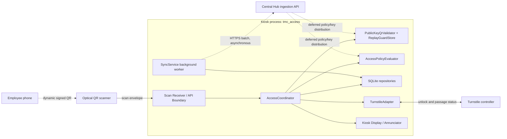
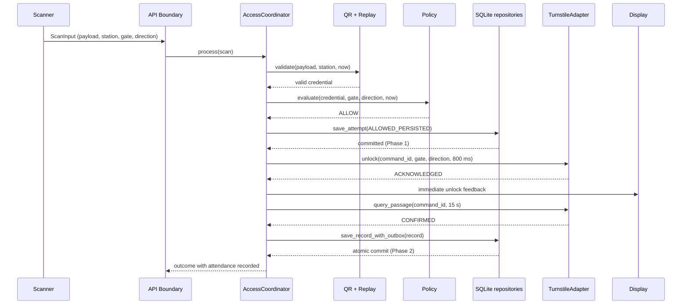

# Component-and-Connector View

| Metadata | Value |
|---|---|
| System | TMC QR-Based Attendance & Access Control System |
| Module | Edge Gate Access Processing (`tmc_access`) |
| Milestone | M2 |
| Owner | Nguyen Tran Tuan Khai |
| Baseline | Assignment 1 (`Assignment1_Group6.pdf`), ADR-001..004 |
| Related contracts | [`docs/contracts/edge-access-contracts.md`](../contracts/edge-access-contracts.md) |
| Related static view | [`module-view.md`](module-view.md) |
| Status | Target runtime view; the repository remains an implementation scaffold |

## 1. Purpose and view boundary

The Module View explains where code is organized. This Component-and-Connector
(C&C) View explains what participates at runtime, how those participants
communicate, and how the access lifecycle progresses through success and
failure states.

The boundary is the **factory gate station**. The components inside the kiosk
process are the Edge module's runtime participants. The scanner, turnstile
controller, Hub, employee phone, NTP service, and HR/Payroll system are
external devices or services. The Hub and HR/Payroll implementation are
outside M2; only the `SyncClient` boundary is represented here.

The diagram is a runtime interaction view, not a deployment guarantee. The
repository does not specify a kiosk service manager or a vendor protocol.
`MockTurnstileAdapter` is the deterministic implementation used by tests;
`VendorTurnstileAdapter` remains subject to OD-13.

### Visual notation and semantic legend

- **Boxes** are computational components. The `Kiosk process` border identifies
  components executing inside the kiosk OS process; external devices and
  services are outside that boundary.
- **Solid arrows** represent synchronous control initiation. A bidirectional
  solid arrow represents a request-response or polling handshake.
- **Dashed arrows** represent asynchronous or deferred interactions. The
  phone-to-scanner edge is a physical optical presentation; the SyncService
  and policy/key distribution edges are asynchronous network interactions.
- **Cylinders** represent persistent stores. The SQLite file is not drawn as a
  separate top-level component because it is internal state of the repository
  component.

## 2. Runtime component catalog

| Component | Provided ports | Required ports | Runtime responsibility and key state |
|---|---|---|---|
| **Scan Receiver / API Boundary** (`presentation/api`) | `ScanIngressPort` | `AccessCoordinatorPort` | Accepts a scanner `ScanInput`, validates the envelope, redacts the payload from representations, and dispatches to the coordinator. |
| **AccessCoordinator** (`application/access`) | `AccessCoordinatorPort` | `ValidationPort`, `PolicyPort`, `AuditPersistencePort`, `GateControlPort`, `AttendancePersistencePort`, `UserFeedbackPort` | Orchestrates validation, policy, Phase 1 attempt persistence, unlock, passage monitoring, feedback, and Phase 2 attendance persistence. A Phase 1 failure prevents unlock. |
| **PublicKeyQrValidator + ReplayGuardStore** (`infrastructure/qr`) | `ValidationPort` | `PublicKeySnapshotPort`, `ReplayStatePort` | Verifies signed QR credentials with cached public keys and atomically checks/records `jti`. Private signing keys remain in the Hub; replay restart and multi-scanner behavior remain OD-08. |
| **AccessPolicyEvaluator** (`domain/policies`) | `PolicyPort` | `PolicySnapshotPort` | Evaluates station/gate, direction, employee status, and policy freshness. Missing or too-stale policy denies locally and never calls the Hub synchronously. |
| **SQLite persistence managers** (`infrastructure/persistence`) | `AuditPersistencePort`, `AttendancePersistencePort`, `OutboxReadPort`, `OutboxStatusPort` | `SqliteEnginePort` | Stores attempts and atomically stores confirmed attendance plus outbox state. SQLite WAL, `synchronous=NORMAL`, foreign keys, and a 5,000 ms busy timeout are execution details. Schema and sequence details remain OD-11. |
| **TurnstileAdapter** (`infrastructure/turnstile`) | `GateControlPort` | `VendorHardwarePort` | Sends bounded unlock commands and separately queries passage. `ACKNOWLEDGED` is not passage; the configured unlock timeout is 800 ms and the passage window is 15 seconds. |
| **SyncService** (`application/synchronization` plus `infrastructure/synchronization`) | `SyncWorkerPort` | `OutboxReadPort`, `OutboxStatusPort`, `HubBatchPort` | Obtains pending records, sends batches, and marks only Hub-accepted IDs synchronized. Delivery is at least once with configured backoff/jitter; Hub authentication remains OD-10. |
| **Kiosk Display / Annunciator** (`presentation/api` boundary) | `UserFeedbackPort` | `DisplayDevicePort` | Presents bounded visual/audio feedback for denial, unlock acknowledgement, timeout, and final passage/attendance outcomes. |

The public-key and policy snapshots are local data owned by the validator and
policy evaluator, not additional computational components. Their distribution
mechanism is explicitly deferred to OD-09.

## 3. Connector catalog

| Connector | Roles | Nature and mechanism | Concurrency, buffering, guarantees, and failure behavior |
|---|---|---|---|
| **Scanner ingress channel** | `Scanner: Publisher` → `Scan Receiver: Receiver` | External scanner-to-kiosk transport; USB, serial, LAN, or keyboard-wedge mechanism is deployment-specific and unconfirmed by A1. | The API validates and bounds the envelope, rejects malformed input, and never logs raw payloads. Input buffering and scanner framing are deployment concerns, not a domain contract. |
| **In-process method call** | `Caller: required port` → `Callee: provided port` | Synchronous Python calls through domain `Protocol`s; no network serialization. | The ingress coordinator call blocks its request worker while local stages execute; bounded stage timeouts protect the response budget. No unbounded queue is implied. |
| **SQLite local persistence** | `AccessCoordinator/SyncService: repository clients` ↔ `SQLite repositories: persistence service` | SQLite C bindings and file-backed SQL transactions; the database file is internal state of this component. | SQLite serializes writers and permits readers under WAL. Busy timeout is 5,000 ms, but the access-path persistence budget is 200 ms: on budget exhaustion or storage failure, the request fails closed. |
| **Hardware driver interface** | `TurnstileAdapter: Master/Controller` ↔ `Turnstile controller: Actuator` | Vendor/serial/USB/LAN mechanism hidden behind `GateControlPort`; exact vendor protocol is OD-13. | `unlock` has an 800 ms bound. Unlock acknowledgement and passage polling are separate; uncertain outcomes are not blindly retried. |
| **Kiosk feedback channel** | `AccessCoordinator: Feedback publisher` → `Kiosk Display: Annunciator` | In-process feedback port to a local display/audio device. | Bounded, best-effort presentation; failure to display must not convert denial or an unconfirmed passage into success. |
| **HTTPS batch channel** | `SyncService: Sender/Publisher` → `Central Hub: Receiver/Collector` | Asynchronous HTTPS/TLS transport with batches. | At-least-once delivery; Hub deduplicates by stable transaction identifier. HTTP 429/503 uses approximately 5, 10, 20, 40, 60 second backoff with jitter. Outbox capacity is not fixed by the architecture; disk-full behavior is an operational/OD-11 decision, not FIFO dropping or silent gate success. |
| **Policy/key distribution (deferred)** | `Central Hub: Publisher` → `Validator/Policy: Snapshot receivers` | Placeholder asynchronous distribution connector; mechanism is OD-09. | No synchronous dependency is allowed on the access path. Until adopted, local snapshots are the only inputs and freshness rules govern denial. |

All connectors use the named roles above; a connector does not imply that
components share mutable in-memory state.

## 4. Dynamic interaction scenarios

### 4.1 Normal success: two-phase persistence

The following is the proposed OD-04 ordering recorded by the contracts and
interfaces. It is the target behavior, not evidence that the current scaffold
has implemented the flow.

1. The scanner sends an envelope containing request, station, gate, direction,
   reception time, and raw payload. The API boundary redacts the payload in
   logs and representations.
2. The coordinator validates signature, claims, expiry, key status, and replay
   locally, then evaluates the cached policy.
3. If both checks allow access, it commits an `AccessAttempt` with
   `ALLOWED_PERSISTED`. The coordinator does not issue a gate command before
   this durable commit.
4. It calls `GateAdapter.unlock`. Only `GateAck.ACKNOWLEDGED` enters the
   passage-monitoring window. The kiosk may provide immediate visual/audio
   feedback at this point; acknowledgement is not attendance.
5. During the separate 15-second window, `query_passage` waits for physical
   evidence. Only `PassageStatus.CONFIRMED` advances the attempt.
6. The coordinator calls `save_record_with_outbox`. The authoritative
   `AttendanceRecord` and its outbox row commit in one local transaction.
7. `SyncService` later uploads the outbox item. The item becomes synchronized
   only when the Hub includes its stable identifier in `accepted_record_ids`.

### 4.2 Rejection and policy denial: fail closed

For malformed, invalid, expired, or replayed QR input, the validator returns a
non-valid result. For missing, corrupt, inactive, or stale policy, the policy
component returns a normal `DENY` decision. The coordinator persists a denied
`AccessAttempt` with a reason such as `QR_REJECTED`, `POLICY_MISSING`, or
`POLICY_STALE`, returns denial feedback, and **does not call the gate**.

If the denial audit write fails, the request is still fail-closed: no unlock is
issued and no success is reported. No attendance record or outbox row is
created for any denial.

### 4.3 Hardware failure and passage uncertainty

After a successful Phase 1 commit:

1. `REJECTED` updates the attempt to `UNLOCK_REJECTED`; no attendance is
   created.
2. `TIMEOUT` updates it to `UNLOCK_TIMEOUT`; the controller outcome is
   uncertain, so the unlock is not blindly retried and no attendance is
   created.
3. `UNAVAILABLE` is retained as a failed/uncertain attempt; no attendance is
   created.
4. `ACKNOWLEDGED` followed by `NOT_CONFIRMED`, `UNKNOWN`, or `UNAVAILABLE`
   updates the attempt to `PASSAGE_UNRESOLVED`. The kiosk must not claim
   attendance, and no Phase 2 outbox row is created.
5. `CONFIRMED` updates the attempt to `PASSAGE_CONFIRMED` and enables the
   atomic Phase 2 write. If that write fails, neither attendance nor outbox is
   reported as committed.

The controller acknowledgement fallback described in the A1 baseline is not
silently adopted: whether `ACKNOWLEDGED` can ever count as attendance is OD-05
and outside the confirmed C&C behavior.

### 4.4 Offline operation and store-and-forward

The scan-to-unlock sequence uses only the local public-key/policy state, gate
adapter, and SQLite. A WAN outage therefore does not block local authorization
while the policy remains within its configured usable-staleness rules. Confirmed
attendance records accumulate as `PENDING` outbox items.

The background loop obtains the oldest pending batch and sends it through the
Hub connector. Accepted IDs are marked synchronized. Network errors and HTTP
429/503 leave items pending and schedule capped exponential backoff with
jitter. Permanent item errors are quarantined so one poison item does not
stall unrelated records. A duplicate with identical content is idempotently
accepted; a conflicting duplicate remains a conflict for investigation.

## 5. Kiosk response-time budget

This budget is the allocation in
[`edge-access-contracts.md`](../contracts/edge-access-contracts.md), not a
benchmark result. It covers scan reception through immediate unlock feedback;
the 15-second passage monitor and synchronization are deliberately decoupled.

| Stage | Runtime component | Target | Hard bound / fallback |
|---|---|---:|---|
| Scan capture and envelope parsing | Scan Receiver / API Boundary | ≤ 30 ms | 100 ms; reject malformed envelope |
| Cryptographic verification and replay check | PublicKeyQrValidator + ReplayGuardStore | ≤ 20 ms | 50 ms; deny invalid, expired, or replayed input |
| Local policy evaluation | AccessPolicyEvaluator | ≤ 10 ms | 50 ms; deny missing or stale policy |
| Phase 1 attempt persistence | SQLite repository | ≤ 30 ms | 200 ms; fail closed and do not unlock |
| Turnstile unlock pulse | TurnstileAdapter | ≤ 200 ms | 800 ms; record timeout and fail closed |
| Immediate user feedback | API boundary / kiosk display | ≤ 50 ms | 300 ms; return a bounded error/prompt |
| **Ingress authorization total** | **All above** | **≤ 340 ms** | **≤ 1,500 ms** |
| Passage monitoring | Background gate sensor query | Asynchronous | Separate 15-second window |

The remaining allowance to the hard 2,000 ms requirement is reserved for
operating-system scheduling and jitter. No synchronous Hub request is allowed
on this path. Meeting these targets under the 2–5 TPS factory burst target
requires implementation and performance testing; the scaffold does not yet
verify that result.

## 6. Invariants and open-decision boundaries

- **OD-04 — write ordering:** the target C&C sequence is Phase 1
  `AccessAttempt` commit → unlock → passage → atomic Phase 2
  `AttendanceRecord` plus outbox commit. It remains a proposed repository
  resolution until the decision register is formally updated.
- **OD-08 — replay state:** this view requires an atomic replay check and
  record, but does not decide persistence across restart or behavior with
  multiple scanners.
- **OD-10 — Edge-to-Hub authentication:** this view requires an asynchronous
  `SyncClient` and accepted-ID acknowledgement, but does not declare mTLS,
  application authentication, or a final endpoint as adopted.
- **OD-13 — vendor turnstile API:** this view specifies only the stable
  `GateAdapter` port and its timeout/result semantics. The vendor protocol is
  external and unresolved; the mock adapter is the test implementation.

Other lifecycle boundaries are normative: `AccessAttempt` is an audit entity
and is not an `AttendanceRecord`; unlock acknowledgement is not passage;
local persistence is not synchronization acknowledgement; and no stage may
report success for a later stage that has not committed.

## 7. Traceability and implementation status

The runtime participants map to `domain/interfaces`, `application`, and
`infrastructure` as described by [`module-view.md`](module-view.md). The
health and scan API boundary, deterministic mock turnstile, and SQLite WAL
setup are scaffolded and tested. QR verification, policy evaluation,
coordination, repositories, synchronization, and the vendor adapter remain
pending implementation; pending tests are not passes.
