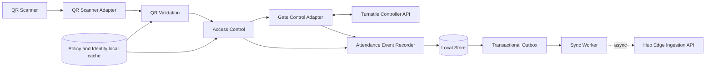

# Component-and-Connector View

**Owner:** Nguyen Tran Tuan Khai. *Template; components and connectors below are taken from A1 Figure 2 (inspected as an image) and Figure 4.*

## Purpose
Show runtime components at the factory edge and how they interact during a scan and synchronization.

## Components (A1 Table 10, Figure 2)
QR Scanner (device) → QR Scanner Adapter → QR Validation → Access Control → Gate Control Adapter ↔ Turnstile Controller API; Attendance Event Recorder; Local Store (events and policy), Transactional Outbox, Sync Worker; Policy and Identity signed local cache (fed by the Hub). Edge shared services: cryptography, audit, metrics.

## Connectors and interaction
- Scanner → Edge: scan payload, station id, reception time, local request id (A1 Table 24).
- Edge → Turnstile: unlock request; command/status query; passage confirmation if supported (Table 24). Command acknowledgement and passage are separate results.
- Edge → Hub: asynchronous batches, at-least-once, idempotent on the event id (§3.5.5). Local decisions never depend on it.
- Hub → Edge: versioned policy snapshots (distribution mechanism pending, OD-09).

Scan sequence (A1 Figure 4, redrawn from the image, **not** the proposed ordering):
1. Scan → validation and access control read policy, key and replay state from the local store.
2. DENY path: write deny audit reason; return DENY + reason.
3. ALLOW path (Figure 4): atomic write of attempt + pending outbox → unlockGate(attemptId) → ACK / timeout / rejection → update outcome, create attendance only on success → display result.
4. Asynchronously: sync batch when the WAN is available; Hub returns accepted event ids; rejected items retried.

The ordering proposed for implementation (attempt → unlock → passage → record + outbox atomic) differs from Figure 4 step 4B and is **Pending** (OD-04).

## Relationship to Edge Gate Access Processing
These are the runtime components the module implements. Only the Edge half is in scope.

## Open decisions
OD-04, OD-05, OD-08, OD-09, OD-10. See [decisions.md](decisions.md#open-decisions). Concurrency of simultaneous scans on one gate is not specified beyond "prevent overlapping gate commands for the same attempt" (A1 Table 26).
