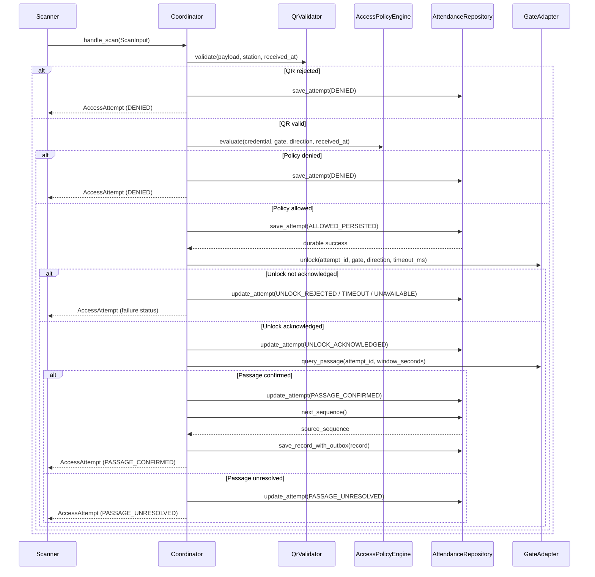

# Edge Access Core Design

**Owner:** Nguyen Ngoc Kim  
**Implementation:** `application/access`, `domain/policies`, `domain/models`,
`tests/unit/access`

## Scope and assumptions

This implementation follows the repository's documented bootstrap assumptions while OD-04
and OD-05 remain team decisions:

- Persist an allowed `AccessAttempt` before sending an unlock command.
- Create `AttendanceRecord` plus outbox only after confirmed physical passage.
- A controller acknowledgement is not passage and does not create attendance by itself.
- QR validation, policy evaluation, unlock acknowledgement, passage confirmation, attendance
  creation, persistence and central synchronization remain separate lifecycle stages.

The Assignment 1 source is internally inconsistent on these two points. Sections 3.5.1,
4.2.3 and 5.3.2 require the access request before unlock and authoritative attendance after
passage, while ADR-003 item 3 says the access request and generated attendance event are both
written before unlock. Section 3.5.3 permits controller ACK when sensors are unavailable,
while section 5.3.2 calls passage authoritative. The implementation uses the safer lifecycle
above and does not claim that OD-04 or OD-05 has been formally resolved.

## Class design

```mermaid
classDiagram
    direction TB
    class AccessCoordinator {
      +handle_scan(ScanInput) AccessAttempt
    }
    class QrValidator {
      <<interface>>
      +validate(payload, station_id, now) QrValidationResult
    }
    class AccessPolicyEngine {
      <<interface>>
      +evaluate(credential, gate_id, direction, now) AccessDecision
    }
    class AccessPolicyEvaluator {
      +evaluate(credential, gate_id, direction, now) AccessDecision
    }
    class PolicySnapshotProvider {
      <<interface>>
      +get_snapshot() PolicySnapshot
    }
    class GateAdapter {
      <<interface>>
      +unlock(command_id, gate_id, direction, timeout_ms) GateCommandResult
      +query_passage(command_id, window_seconds) PassageStatus
    }
    class AttendanceRepository {
      <<interface>>
      +save_attempt(AccessAttempt)
      +update_attempt(AccessAttempt)
      +save_record_with_outbox(AttendanceRecord)
      +next_sequence() int
    }
    class PolicySnapshot
    class AccessAttempt
    class AttendanceRecord

    AccessCoordinator --> QrValidator
    AccessCoordinator --> AccessPolicyEngine
    AccessCoordinator --> GateAdapter
    AccessCoordinator --> AttendanceRepository
    AccessCoordinator ..> AccessAttempt
    AccessCoordinator ..> AttendanceRecord
    AccessPolicyEvaluator ..|> AccessPolicyEngine
    AccessPolicyEvaluator --> PolicySnapshotProvider
    AccessPolicyEvaluator ..> PolicySnapshot
```

## Decision flow

If the first durable attempt write fails, the coordinator stops before calling the gate. If a
later write fails, it raises the categorized storage error and never reports durable success.

## AccessAttempt versus AttendanceRecord

| Concept | Creation rule | Purpose |
|---|---|---|
| `AccessAttempt` | Every processed scan outcome | Audit validation, authorization, gate and passage status |
| `AttendanceRecord` | Confirmed passage only under the current OD-05 assumption | Authoritative attendance event linked by `access_attempt_id` |

The attempt records `policy_version` and `stale_cache_used` so offline decisions are auditable.
The attendance record carries the policy version and controller acknowledgement. Its
`transaction_id` is generated once as a UUID and is reused by the outbox.

## Policy rules

- Snapshot age up to the configured fresh window: evaluate normally.
- Age above the fresh window and up to the maximum stale window: evaluate locally and set
  `stale_cache_used=True`.
- Snapshot older than the maximum stale window: deny with `POLICY_STALE`.
- Missing snapshot: deny with `POLICY_MISSING`.
- Inactive subject: deny with `EMPLOYEE_INACTIVE`.
- Missing gate/direction grant or a grant outside its permitted time window: deny with
  `NOT_AUTHORIZED_FOR_GATE`.
- Unreadable, malformed or future-dated cache: raise `PolicyError` and fail closed.

Cache windows are injected from `Settings`; they are not domain constants.

## SOLID mapping

- **Single Responsibility:** validation, policy evaluation, gate control and persistence remain
  separate collaborators; the coordinator only orchestrates the use case.
- **Open/Closed:** new validators, policy sources, turnstile adapters and repositories can be
  introduced behind existing protocols without rewriting the decision flow.
- **Liskov Substitution:** every `GateAdapter` keeps acknowledgement separate from physical
  passage; an adapter cannot substitute ACK for attendance evidence.
- **Interface Segregation:** QR, policy, gate and repository ports expose only the operations
  needed by their consumers.
- **Dependency Inversion:** `AccessCoordinator` depends on domain protocols and receives every
  collaborator and operational value through constructor injection.

## Verification

Unit tests cover QR rejection, policy denial, missing/stale policy, inactive employees,
gate/direction authorization, write-before-unlock, all gate failure outcomes, ACK without
passage, confirmed passage, policy audit metadata and attendance/outbox creation.

## AI use declaration for LMS

- **Tool:** OpenAI Codex.
- **Use:** inspected the repository contracts, assisted implementation of the Edge access core,
  generated unit-test cases and drafted this design/SOLID documentation.
- **Verification:** implementation was reviewed against the repository contracts and checked by
  Ruff, architecture checks, secret scanning and pytest on Python 3.12.
- **Data:** only synthetic identifiers and test data were used; no real employee data, QR token,
  private key or credential was provided to the tool.

Copy this declaration into the LMS template without removing any additional fields required by
the course form.
