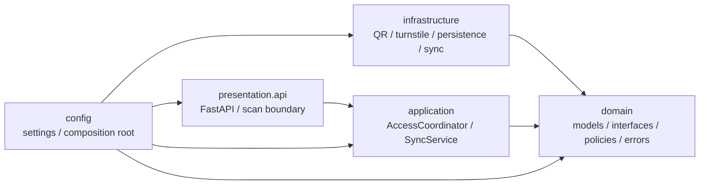

# Module View

| Metadata | Value |
|---|---|
| System | TMC QR-Based Attendance & Access Control System |
| Module | Edge Gate Access Processing (`tmc_access`) |
| Milestone | M2 |
| Owner | Nguyen Tran Tuan Khai |
| Course | Software Architecture (CO3017), HCMUT |
| Baseline | Assignment 1 (`Assignment1_Group6.pdf`), ADR-001..004 |
| Related contracts | [`docs/contracts/edge-access-contracts.md`](../contracts/edge-access-contracts.md) |
| Status | Integrated A2 prototype; core Edge use cases and SQLite/Outbox persistence implemented; vendor hardware and Hub ingestion remain simulated/stubbed |

## 1. Purpose and scope

This view describes the static decomposition of the Edge Gate Access Processing
module, its compile-time dependency direction, its ports and adapters, and the
rules that keep business decisions independent of frameworks, hardware, storage,
and network transports.

The module covers QR validation, local access-policy evaluation, turnstile
interaction, attendance recording, local persistence, and asynchronous
store-and-forward synchronization. Hub modules, the mobile application,
HR/Payroll integration, and proprietary vendor protocols are external to this
view.

## 2. Architectural style

The module uses a **Hexagonal (Ports-and-Adapters) architecture implemented
with inward layered dependencies**:

- The **domain** is the center. It contains lifecycle models, errors, pure
  policy abstractions, and ports. It does not depend on frameworks or external
  systems.
- The **application** layer orchestrates use cases and depends on domain ports,
  never on concrete adapters.
- The **infrastructure** layer implements ports for QR cryptography, replay
  state, turnstiles, SQLite, and Hub communication.
- The **presentation** layer exposes the scanner/API boundary and calls the
  application layer.
- The **configuration/composition root** is the only place that assembles
  concrete implementations into the object graph.



### Diagram Legend

- **Rectangular box:** Static implementation unit or Python package
  (`tmc_access.*`).
- **Solid arrow (`A → B`):** Compile-time import dependency; `A` imports `B`.
- **Layer boundary:** Inward dependency rule:
  `presentation → application → domain ← infrastructure`.

The arrows represent compile-time imports. Runtime control may flow through a
domain port to an infrastructure adapter, but the domain never imports the
adapter.

`config` is a composition root, not a business layer. Hub implementation and
mobile application modules are not included in this repository.

## 3. Element catalog

| Package or element               | Responsibility and key elements                                                                                                                                               | Depends on                                                                | A1 mapping                            | Owner            |
|----------------------------------|-------------------------------------------------------------------------------------------------------------------------------------------------------------------------------|---------------------------------------------------------------------------|---------------------------------------|------------------|
| `domain/models`                  | Lifecycle data and result types: `ScanInput`, `AccessAttempt`, `AccessDecision`, `VerifiedCredential`, `GateCommandResult`, `PassageStatus`, `AttendanceRecord`, `SyncResult` | Standard-library types only and other domain models                       | Tables 16, 25, 30; section 5.3.2      | Shared contract  |
| `domain/interfaces`              | Seven ports: `QrValidator`, `ReplayGuard`, `AccessPolicyEngine`, `GateAdapter`, `AttendanceRepository`, `OutboxRepository`, `SyncClient`                                      | `domain.models`, `Protocol`                                               | Figure 6 interfaces; Tables 16 and 31 | Khai (Contracts) |
| `domain/policies`                | Pure local access-policy rules through `AccessPolicyEvaluator`                                                                                                                | `domain.models`                                                           | Access Control                        | Kim              |
| `domain/errors.py`               | Structured domain/infrastructure error categories such as QR, policy, gate, storage, and sync errors                                                                          | Standard library                                                          | Failure taxonomy                      | Shared           |
| `application/access`             | `AccessCoordinator`: scan -> QR result -> policy decision -> attempt persistence -> gate -> passage -> attendance/outbox flow                                                 | Domain ports and models only                                              | Access Control / Attendance Recorder  | Kim              |
| `application/synchronization`    | `SyncService` and `SyncRetryWorker`: obtain pending outbox records, push batches with configured backoff, and apply Hub acknowledgements                                   | `OutboxRepository`, `SyncClient`                                          | Background Sync Worker                | Nhat             |
| `infrastructure/qr`              | `PublicKeyQrValidator` and `ReplayGuardStore`; public-key verification (Ed25519 two-part prototype) and in-memory replay state                                                | Domain models/interfaces; `cryptography` and threading `Lock`             | QR Validation                         | Hieu             |
| `infrastructure/turnstile`       | `MockTurnstileAdapter` (implemented) and `VendorTurnstileAdapter` (stub) implement gate behavior                                                                              | `GateAdapter`, domain gate models                                         | Gate Control Adapter                  | Nhat             |
| `infrastructure/persistence`     | SQLite WAL connection and `SqliteAttendanceRepository` / `SqliteOutboxRepository`                                                                                             | Domain repository ports/models; `sqlite3`                                 | Local Store and Transactional Outbox  | Nhat             |
| `infrastructure/synchronization` | `SimulatedSyncClient`, `SimulatedHubReceiver`, `HttpSyncClient` (stub), and `BackoffConfig` for Hub transport and operational retry configuration                           | `SyncClient`, domain models, HTTP/configuration libraries                 | Sync Worker / Ingestion Client        | Nhat             |
| `presentation/api`               | FastAPI health endpoint and scan simulation boundary; maps an HTTP request to `ScanInput`                                                                                     | `AccessCoordinator`, domain models, FastAPI/Pydantic                      | QR Scanner Adapter (simulation)       | Kim              |
| `config`                         | `Settings`, `Container`, `build_gate`, and `build_container`; wires concrete adapters                                                                                         | All outer-layer packages and settings                                     | Shared services / composition root    | Khai / Viet      |

All packages above are part of the Edge module. The Hub is represented only by
the `SyncClient` boundary and the allocation documentation.

## 4. Ports and adapter realizations

The following seven protocols are the integration points that must remain
stable across component ownership boundaries.

| Port in `domain/interfaces/` | Contract | Concrete realization | Status and notes |
|---|---|---|---|
| `QrValidator` | `validate(raw_payload, station_id, now) -> QrValidationResult`; verifies format, signature, claims, expiry, key status, and replay outcome | `infrastructure.qr.PublicKeyQrValidator` | Implemented A2 prototype: verifies 2-part Ed25519 token (`base64url(JSON).base64url(sig)`), required claims (`sub`, `jti`, `kid`, `aud`, `iss`, `iat`, `exp`), 0 s clock skew |
| `ReplayGuard` | `check_and_record(token_id, expires_at, now) -> bool`; atomically accepts first use and rejects replay | `infrastructure.qr.ReplayGuardStore` | Implemented in-memory thread-safe store (`Lock`); persistence across restarts/multi-scanner behavior remains OD-08 |
| `AccessPolicyEngine` | `evaluate(credential, gate_id, direction, now) -> AccessDecision`; returns ALLOW or normal DENY | `domain.policies.AccessPolicyEvaluator` | Implemented offline rules (`fresh_for=300s`, `max_stale_for=7200s`) via `PolicySnapshotProvider` |
| `GateAdapter` | `unlock(command_id, gate_id, direction, timeout_ms) -> GateCommandResult` and `query_passage(command_id, window_seconds) -> PassageStatus` | `MockTurnstileAdapter`; `VendorTurnstileAdapter` | `MockTurnstileAdapter` implemented for deterministic outcomes; `VendorTurnstileAdapter` remains stubbed (OD-13) |
| `AttendanceRepository` | `save_attempt`, `update_attempt`, atomic `save_record_with_outbox`, and `next_sequence` | `SqliteAttendanceRepository` | Implemented with SQLite WAL (`synchronous=FULL`, `foreign_keys=ON`); `next_sequence()` is monotonic per kiosk DB (OD-11 production scope open) |
| `OutboxRepository` | `get_pending`, `mark_synchronized`, `mark_rejected`, and `mark_conflict` | `SqliteOutboxRepository` | Implemented against `outbox_events` (`PENDING`, `SYNCED`, `REJECTED`, `CONFLICT`) |
| `SyncClient` | `push_events(batch) -> SyncResult`; at-least-once delivery with accepted, rejected, and conflict outcomes | `SimulatedSyncClient`; `HttpSyncClient` | `SimulatedSyncClient` (+ `SimulatedHubReceiver`) implemented for simulation/tests; `HttpSyncClient` remains stubbed (OD-10) |

Ports use domain types deliberately. For example, `GateAck.ACKNOWLEDGED` is
only an unlock acknowledgement and never a passage result; `AttendanceRecord`
is separate from `AccessAttempt`; and synchronization uses the stable
`AttendanceRecord.transaction_id` for retry idempotency.

## 5. Layer isolation and boundary rules

These rules are non-negotiable compile-time constraints:

1. **The domain imports no outer layer.** `domain` must not import
   `application`, `infrastructure`, `presentation`, `config`, FastAPI, or
   Pydantic. Domain models and ports remain usable without a web server,
   database driver, or hardware SDK.
2. **Application code depends only on domain abstractions.**
   `application` may orchestrate `domain.interfaces` and `domain.models`, but
   must not import concrete QR, SQLite, turnstile, HTTP, presentation, or
   configuration classes.
3. **Infrastructure implements ports rather than changing them.**
   QR, gate, persistence, and synchronization adapters depend inward on domain
   contracts. They must not call application services or presentation code.
4. **Presentation calls application services, not adapters.**
   API and scanner boundaries translate external input into domain/application
   input and do not construct or invoke concrete infrastructure components.
5. **Only the composition root wires concrete implementations.**
   `config/container.py` selects adapters and injects them into application
   services. This keeps replacement of a vendor gate, database, or Hub client
   local to the composition boundary.

Operational settings are deliberately outside the domain. Retry delays,
backoff jitter, cache freshness/staleness windows, network timeouts, and
passage windows vary by deployment and failure environment; they are not
business invariants. They belong in `config.settings` and infrastructure
configuration such as `BackoffConfig`. Keeping them out of the domain prevents
policy and lifecycle models from acquiring transport concerns and keeps unit
tests deterministic.

The lifecycle boundary is also enforced conceptually across layers:

```text
QR validation
-> access authorization
-> unlock acknowledgement
-> passage confirmation
-> attendance record
-> local persistence
-> synchronization acknowledgement
```

No layer may collapse an unlock acknowledgement into physical passage or an
authorization decision into attendance.

## 6. Architectural enforcement

`tests/unit/test_smoke_architecture.py` provides the executable module-view
guardrails:

- `test_all_modules_import` walks the `tmc_access` package with `pkgutil` and
  imports every discovered module, catching broken package boundaries and
  import-time wiring errors.
- `test_layer_does_not_import_outer_layers` parses Python files with the
  standard-library `ast` module. It checks each layer against a forbidden
  import set:

  | Layer | Forbidden dependencies |
  |---|---|
  | `domain` | `application`, `infrastructure`, `presentation`, `config`, FastAPI, Pydantic |
  | `application` | `infrastructure`, `presentation`, `config`, FastAPI |
  | `infrastructure` | `application`, `presentation`, `config`, FastAPI |
  | `presentation` | `infrastructure`, `config` |

- `test_domain_has_no_sync_retry_settings` scans domain source to ensure
  operational names such as `backoff_delays`, `jitter_min`, and
  `max_stale_seconds` do not leak into domain code.

The test suite also checks composition-root wiring, model lifecycle invariants,
and deterministic mock turnstile behavior. These tests enforce structure and
contracts; they do not imply that the currently stubbed business flows are
complete. Pending scenarios remain explicitly marked `PENDING` until real
implementations and integration tests replace them.

## 7. Relationship to other architecture views

- The **Component-and-Connector View** describes runtime calls between these
  modules, including the access sequence, passage monitoring, and background
  synchronization.
- The **Allocation View** maps the kiosk runtime, scanner, turnstile, local
  database, public-key cache, Hub, and external HR/Payroll system to physical
  nodes and networks.
- The **Contracts** document defines the data, error, atomicity, and
  idempotency rules at the ports listed above.
- **Access Core Design ([`edge-access-core-design.md`](edge-access-core-design.md))**:
  documents Kim's class design, decision flow, and SOLID mapping for
  `AccessCoordinator` and `AccessPolicyEvaluator`.

## 8. Open decisions and implementation status

The authoritative decision register is
[`decisions.md`](decisions.md#open-decisions). The module view must not silently
resolve those questions:

- OD-01: QR signing and issuance responsibility.
- OD-02: QR claim set and cryptographic details.
- OD-04: write ordering around unlock and attendance creation.
- OD-08: replay-state persistence and restart behavior.
- OD-10: Edge-to-Hub authentication and ingestion API.
- OD-11: persistence schema and sequence-number details.
- OD-13: vendor turnstile API.

The current repository implements and tests the core Edge A2 prototype
(`PublicKeyQrValidator`, `ReplayGuardStore`, `AccessPolicyEvaluator`,
`AccessCoordinator`, `SqliteAttendanceRepository`, `SqliteOutboxRepository`,
`SyncService`, `SyncRetryWorker`, `MockTurnstileAdapter`, and
`SimulatedSyncClient`) under AST-enforced layer boundaries. External/production
adapters (`VendorTurnstileAdapter`, `HttpSyncClient`) and open architectural
decisions (OD-01..OD-13) remain pending team confirmation.
