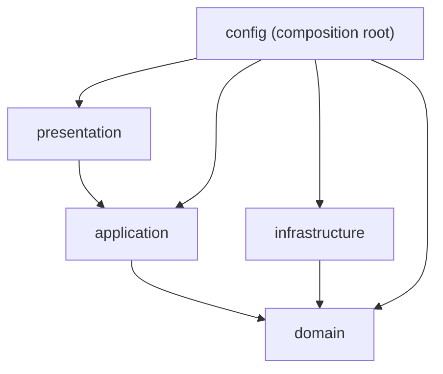

# Module View

**Owner:** Nguyen Tran Tuan Khai. *Template to be completed by the team; the structure below reflects the committed scaffold.*

## Purpose
Show the static code decomposition, dependency rules and responsibilities (Chapter 6 module view).

## Elements

| Package (`src/tmc_access/`) | Responsibility | A1 mapping | Owner |
|---|---|---|---|
| `domain/models` | Lifecycle types: scan, attempt, decisions, gate results, attendance record, sync results | Tables 16, 30 | shared contract |
| `domain/interfaces` | Ports: `QrValidator`, `ReplayGuard`, `AccessPolicyEngine`, `GateAdapter`, `AttendanceRepository`, `OutboxRepository`, `SyncClient` | Fig. 6 interfaces | Khai (contracts) |
| `domain/policies` | Pure access rules | Access Control | Kim |
| `application/access` | `AccessCoordinator` (scan → attendance flow) | Access Control / Attendance Recorder | Kim |
| `application/synchronization` | `SyncService` (outbox → Hub) | Background Sync Worker | Nhật |
| `infrastructure/qr` | Public-key validator, replay store | QR Validation | Hieu |
| `infrastructure/turnstile` | Mock (implemented) and vendor adapter (stub) | Gate Control Adapter | Nhật |
| `infrastructure/persistence` | SQLite WAL connection, repositories | Local Store & Outbox | Nhật |
| `infrastructure/synchronization` | Hub client, backoff configuration | Sync Worker / Ingestion client | Nhật |
| `presentation/api` | FastAPI health and scan simulation boundary | QR Scanner Adapter (simulation) | Kim |
| `config` | Settings and composition root | Shared services (config) | Khai / Viet review |

## Dependency rules

- Domain imports nothing from other layers, nor FastAPI/Pydantic, and holds no operational settings (retry, backoff, cache windows live in `config` and `infrastructure`).
- Application depends on domain abstractions only. Infrastructure implements domain ports. Presentation calls application. Only `config/container.py` knows concrete classes.
- Enforced by `tests/unit/test_smoke_architecture.py` (AST import check).

These rules realize A1's closed-layer decisions (Table 13) for the Edge module.

## Relationship to Edge Gate Access Processing
Every package above belongs to this module. Hub modules are not represented.

## Open decisions
OD-04 (write ordering inside `AccessCoordinator`), OD-11 (persistence schema). See [decisions.md](decisions.md#open-decisions).
