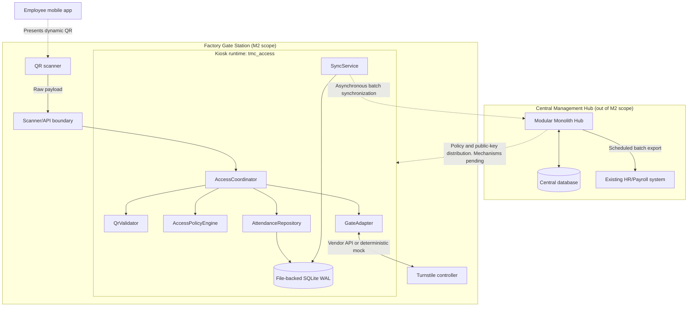

# Architecture Overview

**Owner:** Nguyen Tran Tuan Khai
**Baseline:** Assignment 1 (`Assignment1_Group6.pdf`) and ADR-001..004
**Repository status:** M2 implementation scaffold; several runtime paths remain
unimplemented. This document describes the target architecture and identifies
which behavior is currently verified.

## 1. Purpose and milestone scope

This document is the conceptual anchor for the architecture view packet:

- [Module View](module-view.md)
- [Component-and-Connector View](component-connector-view.md)
- [Allocation View](allocation-view.md)

It explains the system context, the Edge Gate Access Processing module, its
quality attributes, lifecycle boundaries, integration contracts, and
traceability to the codebase.

Milestone 1 established the distributed Edge-Hub topology and ADR-001..004.
Milestone 2 turns the Edge portion of that design into a testable Python
implementation. The current repository contains the package structure,
interfaces, domain invariants, configuration, a deterministic turnstile mock,
and smoke tests. QR verification, access coordination, persistence, outbox
processing, and Hub synchronization are not yet implemented.

## 2. System context

TMC Manufacturing operates two regional production facilities: Binh Duong (approximately 800 employees) and Long An (approximately
600 employees). Shift changes create concentrated ingress and egress traffic.
The design target is 2-5 scans per second per factory; this is a capacity target,
not a performance result currently verified by the scaffold.



The Hub, mobile application, HR/Payroll system, and proprietary hardware
protocols are external systems. The Edge module depends on ports for those
boundaries and does not implement their internal behavior.

## 3. Scope

### 3.1 In scope

- Dynamic signed QR verification using cached public keys.
- Local anti-replay checking.
- Offline access-policy evaluation.
- Turnstile command and passage ports, including deterministic mock behavior.
- Separate `AccessAttempt` audit records and `AttendanceRecord` attendance events.
- File-backed SQLite persistence with WAL configuration.
- Transactional attendance-plus-outbox persistence.
- Store-and-forward synchronization through a `SyncClient` port.
- Unit, integration, and architecture-boundary tests for implemented behavior.

### 3.2 Out of scope

- Hub controllers, Hub database, identity administration, and reporting.
- QR issuance and private signing-key management.
- Mobile application UI and QR rendering.
- HR/Payroll implementation and export processing.
- Proprietary serial, Modbus, or vendor SDK integrations.
- Deployment packaging, service management, Kubernetes, brokers, caches, or
  other infrastructure not defined by the accepted ADRs.

## 4. Quality attributes and design mechanisms

| Driver | Target or requirement | Design mechanism | Current status |
|---|---|---|---|
| NFR1: performance | Kiosk access path <= 2 seconds; local target <= 340 ms | Local QR, policy, persistence, and gate operations; no synchronous WAN call | Target; not benchmarked |
| NFR2/NFR7: survivability | Continue local decisions during WAN loss; policy cache fresh for 5 minutes and usable while stale for up to 2 hours | Local cache, SQLite, transactional outbox, store-and-forward | Configuration exists; runtime paths pending |
| NFR2: data integrity | Avoid loss across process or power failure | SQLite WAL and atomic attendance-plus-outbox write | WAL smoke-tested; repositories pending |
| NFR4: security | Prevent QR cloning/replay and avoid PII exposure | Short-lived signed credentials, public-key verification, replay guard, opaque subject | Ports exist; validator pending |
| Interoperability | Isolate hardware and Hub changes | `GateAdapter` and `SyncClient` domain ports | Ports exist; concrete integrations pending |

These are architectural requirements and implementation targets. The scaffold
does not yet prove 99.99% availability, zero data loss under every failure
mode, 2-5 TPS capacity, or the stated latency budget.

## 5. Architectural decisions and governance

The repository records ADR-001..004 and open decisions in
[decisions.md](decisions.md). This overview does not independently resolve an
open decision.

| Decision | Architectural consequence |
|---|---|
| ADR-001: Edge-Hub topology | Edge nodes make local access decisions; the Hub is the central system of record |
| ADR-002: Dynamic signed QR | Edge verifies credentials with public keys; private signing keys remain outside the Edge |
| ADR-003: Offline-first Edge and outbox | Local persistence and synchronization are separate from the access decision |
| ADR-004: HR/Payroll integration | Scheduled payroll export belongs to the Hub and is outside M2 |
| OD-04 | Proposed flow is attempt persistence -> unlock -> passage -> atomic attendance plus outbox; decision remains tracked in `decisions.md` until formally accepted |
| OD-05 | Controller acknowledgement is not passage; attendance fallback behavior for unavailable sensors remains open |
| OD-08 | Replay-state restart and multi-scanner behavior remain open |
| OD-09 | Policy distribution mechanism remains open |
| OD-10 | Sync endpoint and authentication are a reference proposal until team adoption |
| OD-11 | Domain contract separates `AccessAttempt` and `AttendanceRecord`; final storage schema remains open |
| OD-13 | Vendor turnstile API remains unspecified; the mock adapter is the supported test implementation |

The detailed boundary definitions are in
[`docs/contracts/edge-access-contracts.md`](../contracts/edge-access-contracts.md).
Changes to a shared contract require agreement from affected component owners,
an update to the contracts document, and corresponding test changes.

## 6. Access and attendance lifecycle

The lifecycle deliberately separates authorization, hardware acknowledgement,
physical passage, attendance, persistence, and synchronization:

```text
QR validation
  -> access authorization
  -> unlock acknowledgement
  -> passage confirmation
  -> attendance recording
  -> local persistence
  -> synchronization acknowledgement
```

The proposed runtime flow is:

1. `AccessCoordinator` receives `ScanInput`.
2. `QrValidator.validate(raw_payload, station_id, now)` returns a
   `QrValidationResult`. Rejection denies access and must not call the gate.
3. `AccessPolicyEngine.evaluate(credential, gate_id, direction, now)` returns
   an `AccessDecision`. A denial is a normal result and must not call the gate.
4. The coordinator persists the `AccessAttempt` with
   `AttemptStatus.ALLOWED_PERSISTED`. A storage failure fails closed and prevents
   unlocking.
5. `GateAdapter.unlock(command_id, gate_id, direction, timeout_ms)` returns a
   `GateCommandResult`. `GateAck.ACKNOWLEDGED` means only that the command was
   acknowledged; it is not passage confirmation.
6. The coordinator calls
   `GateAdapter.query_passage(command_id, window_seconds)`. Only
   `PassageStatus.CONFIRMED` permits attendance creation. Other outcomes retain
   an unresolved or failed attempt.
7. `AttendanceRepository.save_record_with_outbox(record)` atomically persists
   the `AttendanceRecord` and its outbox entry.
8. `SyncService` obtains pending records and passes them to `SyncClient`. Hub
   acknowledgement controls which records may be marked synchronized.

The 15-second passage window is separate from the immediate ingress response.
The kiosk may provide immediate command feedback before passage is known, then
record the later passage and attendance outcome.

### Lifecycle invariants

- `AccessAttempt` is an audit entity for every received scan and is distinct
  from `AttendanceRecord`.
- `AttendanceRecord` is not created merely because policy allowed access or the
  controller acknowledged an unlock.
- A failed Phase 1 write prevents an unlock command.
- Attendance and its outbox entry are one atomic local persistence operation.
- Synchronization is at-least-once; transient failures leave records pending.
- A stable `AttendanceRecord.transaction_id` is reused for retries. Any mapping
  to a serialized `record_id` must be documented by the persistence/API owner.

## 7. Architecture views and supporting documents

| View | Document | Main question |
|---|---|---|
| Module | [module-view.md](module-view.md) | How are packages decomposed and how do dependencies flow? |
| Component-and-Connector | [component-connector-view.md](component-connector-view.md) | What runs at runtime and how do components interact? |
| Allocation | [allocation-view.md](allocation-view.md) | Where do software, data, and external systems run? |
| Contracts | [../contracts/edge-access-contracts.md](../contracts/edge-access-contracts.md) | What inputs, outputs, errors, and invariants cross boundaries? |
| Decisions | [decisions.md](decisions.md) | Which architectural choices are accepted, proposed, or open? |

The runtime view should distinguish immediate unlock feedback from the
asynchronous passage-monitoring and synchronization work. The allocation view
should identify the kiosk, scanner, controller, local database, public-key
cache, and network boundary without implying that deployment packaging is
already defined.

## 8. Traceability summary

| Requirement or concern | Governing view or contract | Codebase location | Verification status |
|---|---|---|---|
| Dynamic QR verification and anti-replay | Module, C&C, contracts | `domain/interfaces/qr.py`, `infrastructure/qr/` | Port/scaffold only |
| Offline policy evaluation | Module, C&C, contracts | `domain/interfaces/access.py`, `domain/policies/` | Port/scaffold only |
| Access coordination | C&C, contracts | `application/access/coordinator.py` | `NotImplementedError` |
| Turnstile isolation | Module, Allocation, contracts | `domain/interfaces/gate.py`, `infrastructure/turnstile/` | Mock implemented; vendor stub |
| Lifecycle type separation | Contracts, C&C | `domain/models/access.py`, `gate.py`, `attendance.py` | Invariant tests pass |
| Local WAL persistence | C&C, Allocation, contracts | `infrastructure/persistence/sqlite.py` | WAL setup tested; repositories pending |
| Store-and-forward synchronization | Module, C&C, contracts | `application/synchronization/`, `infrastructure/synchronization/`, `domain/interfaces/sync.py` | Service/client pending |
| Layer dependency direction | Module View | `tests/unit/test_smoke_architecture.py` | Architecture tests implemented |
| Composition-root wiring | Module View | `config/container.py`, `tests/unit/test_wiring.py` | Wiring tested; flows pending |

This traceability table describes the intended implementation mapping and
reports scaffold status honestly; passing smoke tests do not imply that the
pending business flows are complete.
