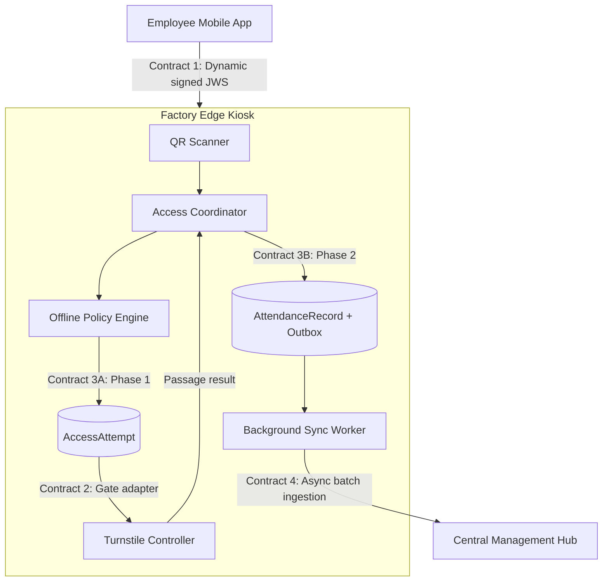

# Edge Access & Synchronization Contracts

This specification defines the formal boundary contracts for the Factory Edge Kiosk
Runtime (`tmc_access`). It governs interactions between scanners, turnstile
controllers, local embedded persistence, and asynchronous Hub synchronization.

## 1. Architectural scope and principles



### Non-negotiable boundary rules

1. **No synchronous WAN dependency (ADR-001).** Credential validation,
   anti-replay checks, and policy evaluation are local operations. The access
   decision path never waits for a Hub round-trip.
2. **Deterministic response budget.** Scan reception through the physical
   unlock request is allocated a maximum of 2,000 ms. Passage monitoring is
   asynchronous and uses a separate 15-second window.
3. **Two-phase persistence (OD-04 resolution).**
   - **Phase 1, pre-unlock:** commit an `AccessAttempt` before pulsing the gate.
   - **Phase 2, post-passage:** after confirmed physical passage, atomically
     commit an `AttendanceRecord` and its outbox entry.
4. **No false attendance.** Denials, gate failures, timeouts, and unconfirmed
   passages are retained as attempts but are not inserted into the attendance
   outbox.
5. **Repository conformance.** Implementations use the exact ports and domain
   types in `src/tmc_access/domain/interfaces/` and
   `src/tmc_access/domain/models/`. Concrete classes are wired only by
   `config/container.py`.
6. **Lifecycle stages remain distinct:**

   ```text
   QR validation
   -> access authorization
   -> unlock acknowledgement
   -> passage confirmation
   -> attendance recording
   -> local persistence
   -> synchronization acknowledgement
   ```

`AccessAttempt` is an audit entity for every scan. `AttendanceRecord` is the
authoritative attendance event and is created only under the confirmed passage
rule above.

## 2. Response-time latency budget

The following allocation supports the 2,000 ms kiosk response requirement under
2-5 TPS peak bursts:

    | Processing stage | Target | Hard timeout / fallback |
|---|---:|---|
| Scan capture and envelope parsing | <= 30 ms | 100 ms; reject malformed input |
| Cryptographic verification and anti-replay | <= 20 ms | 50 ms; deny invalid or expired input |
| Local policy evaluation | <= 10 ms | 50 ms; deny stale or missing policy |
| Phase 1 `AccessAttempt` WAL commit | <= 30 ms | 200 ms; fail closed and do not unlock |
| Turnstile unlock | <= 200 ms | 800 ms; store timeout/error and fail closed |
| Visual/audio feedback | <= 50 ms | 300 ms |
| **Ingress authorization total** | **<= 340 ms** | **<= 1,500 ms** |
| Passage detection | asynchronous | 15,000 ms monitoring window |

The remaining budget is reserved for operating-system scheduling and jitter.
Synchronization is background work and does not add WAN latency to the gate
experience.

## 3. Contract 1: Dynamic QR credential

**Direction:** Mobile App -> Edge Kiosk

**Governing decision:** ADR-002

**Status:** Claims and algorithm baseline established; OD-01 and OD-02 retain
the governance status shown in section 8.

The mobile application renders a compact JWS:

```text
BASE64URL(header).BASE64URL(payload).BASE64URL(signature)
```

### 3.1 Cryptographic boundary

- Primary algorithm: **ES256** (ECDSA P-256 with SHA-256).
- Secondary permitted algorithm: **Ed25519**, where supported by the client and
  Edge verification stack.
- Private signing keys remain in the Central Hub HSM/KMS.
- Edge kiosks contain only the cached public verification key set.
- The Edge performs signature, timestamp, audience/issuer (when present),
  key-status, and replay checks locally.
- Raw QR payloads are secret-like: never log or persist them.

### 3.2 JWS envelope and claims

Header:

```json
{
  "alg": "ES256",
  "typ": "JWT",
  "kid": "tmc-ca-factory-2026-v1"
}
```

Payload:

```json
{
  "sub": "emp_01HV8Z9Q2K4M1N7P5R3T9W2XYZ",
  "iat": 1729000000,
  "exp": 1729000060,
  "jti": "550e8400-e29b-41d4-a716-446655440000",
  "kid": "tmc-ca-factory-2026-v1",
  "iss": "tmc-central-ca",
  "aud": "tmc-factory-kiosk",
  "ver": 1
}
```

| Claim | Status and type | Purpose |
|---|---|---|
| `sub` | Mandatory string (opaque UUID/ULID) | Data minimization; no names, photos, or citizen IDs |
| `iat` | Mandatory integer (Unix seconds) | Reject future-dated credentials outside clock skew |
| `exp` | Mandatory integer (Unix seconds) | Strict 60-second lifetime (`exp - iat == 60`) |
| `jti` | Mandatory UUIDv4 string | Anti-replay identifier |
| `kid` | Mandatory string | Public-key version and key rotation |
| `iss` | Baseline proposal; string | Recommended Central Hub trust domain |
| `aud` | Baseline proposal; string | Recommended Edge kiosk audience |
| `ver` | Baseline proposal; integer | Credential schema version; default `1` |

The implementation port remains:

```python
class QrValidator(Protocol):
    def validate(self, raw_payload: str, station_id: str, now: datetime) -> QrValidationResult: ...
```

### 3.3 Verification rules

- Maximum clock skew is +/-5 seconds.
- The `ReplayGuard` uses a thread-safe in-memory ring buffer of active `jti`
  values and rejects reuse within the validity window.
- Replay-state failure is a `StorageError` and fails closed.
- A rejected credential never calls the gate.
- Expected rejection outcomes include invalid signature, expired, replayed,
  malformed, wrong audience, unknown key, and unreliable clock.

## 4. Contract 2: Turnstile hardware adapter

**Direction:** Edge Kiosk <-> Turnstile Controller
**Governing decisions:** ADR-001 and ADR-003
**Status:** Aligned with the repository ports in
`src/tmc_access/domain/interfaces/gate.py`.

The repository names are authoritative:

```python
class GateAdapter(Protocol):
    def unlock(
        self,
        command_id: str,
        gate_id: str,
        direction: Direction,
        timeout_ms: int,
    ) -> GateCommandResult: ...

    def query_passage(
        self,
        command_id: str,
        window_seconds: int,
    ) -> PassageStatus: ...
```

The corresponding domain types are `Direction`, `GateCommandResult`,
`GateAck`, and `PassageStatus` in `domain/models/gate.py`. The adapter must
return within the supplied timeout. It must not expose passage as part of the
unlock acknowledgement.

### 4.1 Hardware progression

1. Valid QR and policy authorization grant security clearance.
2. `unlock` returns a command acknowledgement.
3. Only an acknowledged command enters the 15-second passage window.
4. `query_passage` returning `CONFIRMED` permits Phase 2 attendance persistence.
5. `NOT_CONFIRMED`, `UNKNOWN`, or `UNAVAILABLE` leaves the attempt unresolved
   and creates no attendance event.

For `TIMEOUT`, `REJECTED`, or `UNAVAILABLE`, the attempt is retained as a
failed or uncertain access attempt. No attendance is recognized. `TIMEOUT` is
an uncertain controller outcome and must not be retried blindly.

The deterministic `MockTurnstileAdapter` covers acknowledged-with-passage,
acknowledged-without-passage, unavailable passage sensing, rejection, timeout,
and controller-unavailable scenarios. The vendor adapter remains outside the
specified hardware API.

## 5. Contract 3: Local persistence and transactional outbox

**Direction:** Edge Kiosk -> local transactional storage

**Governing decision:** ADR-003

**Status:** Two-phase ordering resolved by OD-04; entity separation resolved by
OD-11.

SQLite is file-backed and configured with:

```sql
PRAGMA journal_mode = WAL;
PRAGMA synchronous = NORMAL;
PRAGMA busy_timeout = 5000;
PRAGMA foreign_keys = ON;
```

### 5.1 Persistence phases

**Phase 1, before unlock:** persist the `AccessAttempt` for every evaluated
scan, including denials. A failed durable write prevents the unlock command.

**Phase 2, after confirmed passage:** persist the `AttendanceRecord` and its
outbox entry in one atomic local transaction. A failure leaves neither row
committed and must not be reported as attendance success.

### 5.2 Relational schema reference

```sql
CREATE TABLE IF NOT EXISTS access_attempts (
    attempt_id TEXT PRIMARY KEY,
    employee_id TEXT NOT NULL,
    factory_id TEXT NOT NULL,
    gate_id TEXT NOT NULL,
    direction TEXT NOT NULL CHECK(direction IN ('ENTRY', 'EXIT')),
    attempt_timestamp INTEGER NOT NULL,
    policy_version TEXT NOT NULL,
    decision TEXT NOT NULL CHECK(decision IN ('ALLOW', 'DENY')),
    decision_reason TEXT NOT NULL,
    gate_command_id TEXT,
    gate_ack_status TEXT,
    created_at INTEGER NOT NULL
);

CREATE INDEX IF NOT EXISTS idx_attempts_emp_time
    ON access_attempts(employee_id, attempt_timestamp);

CREATE TABLE IF NOT EXISTS attendance_records (
    record_id TEXT PRIMARY KEY,
    attempt_id TEXT NOT NULL UNIQUE,
    employee_id TEXT NOT NULL,
    factory_id TEXT NOT NULL,
    gate_id TEXT NOT NULL,
    direction TEXT NOT NULL CHECK(direction IN ('ENTRY', 'EXIT')),
    event_timestamp INTEGER NOT NULL,
    passage_status TEXT NOT NULL CHECK(
        passage_status IN ('CONFIRMED', 'UNCERTAIN', 'SENSOR_UNAVAILABLE')
    ),
    time_quality TEXT NOT NULL DEFAULT 'NTP_SYNCED' CHECK(
        time_quality IN ('NTP_SYNCED', 'DEGRADED_RTC')
    ),
    created_at INTEGER NOT NULL,
    FOREIGN KEY(attempt_id) REFERENCES access_attempts(attempt_id)
);

CREATE INDEX IF NOT EXISTS idx_attendance_records_time
    ON attendance_records(event_timestamp);

CREATE TABLE IF NOT EXISTS outbox_sync_queue (
    record_id TEXT PRIMARY KEY,
    payload_json TEXT NOT NULL,
    retry_count INTEGER NOT NULL DEFAULT 0,
    next_retry_at INTEGER NOT NULL DEFAULT 0,
    sync_status TEXT NOT NULL DEFAULT 'PENDING' CHECK(
        sync_status IN ('PENDING', 'IN_FLIGHT', 'ACKNOWLEDGED', 'QUARANTINED')
    ),
    last_error_code TEXT,
    last_error_message TEXT,
    updated_at INTEGER NOT NULL,
    FOREIGN KEY(record_id) REFERENCES attendance_records(record_id) ON DELETE CASCADE
);

CREATE INDEX IF NOT EXISTS idx_outbox_dispatch
    ON outbox_sync_queue(sync_status, next_retry_at);
```

The domain-level repository operations are:

- `save_attempt`
- `update_attempt`
- `save_record_with_outbox` (atomic and idempotent)
- `get_pending`
- `mark_synchronized`
- `mark_rejected`
- `mark_conflict`

`AttendanceRecord.transaction_id` is the stable idempotency identifier at the
domain boundary. The persistence schema's `record_id` is its serialized
storage/API representation.

## 6. Contract 4: Edge-to-Hub synchronization

**Direction:** Edge Sync Worker -> Hub Ingestion API
**Governing decisions:** ADR-003 and ADR-004
**Status:** OD-10 normative reference proposal; endpoint and authentication
remain subject to team adoption.

### 6.1 Transport and endpoint proposal

- Protocol: HTTPS / TLS 1.3.
- Primary authentication: mutual TLS with kiosk X.509 client certificates.
- Secondary application authentication: `Authorization: Bearer <StationToken>`.
- Endpoint: `POST /api/v1/edge/ingestion/events`.
- Headers: `Content-Type: application/json`, `X-Factory-ID`, and `X-Station-ID`.

Request reference:

```json
{
  "batch_id": "9b1deb4d-3b7d-4bad-9bdd-2b0d7b3dcb6d",
  "station_id": "GATE_STATION_BD_01",
  "factory_id": "BINH_DUONG",
  "sent_at": 1729000120500,
  "events": [
    {
      "record_id": "a5e8c1b2-1111-4f1a-b3e2-8822991100aa",
      "attempt_id": "att_88776655-4f1a-b3e2-8822991100aa",
      "employee_id": "emp_01HV8Z9Q2K4M1N7P5R3T9W2XYZ",
      "factory_id": "BINH_DUONG",
      "gate_id": "GATE_01",
      "direction": "ENTRY",
      "event_timestamp": 1729000100120,
      "policy_version": "2026.11.08.01",
      "passage_status": "CONFIRMED",
      "time_quality": "NTP_SYNCED"
    }
  ]
}
```

Response reference:

```json
{
  "batch_id": "9b1deb4d-3b7d-4bad-9bdd-2b0d7b3dcb6d",
  "processed_at": 1729000120750,
  "accepted_record_ids": [
    "a5e8c1b2-1111-4f1a-b3e2-8822991100aa"
  ],
  "rejected_record_ids": [],
  "quarantined_record_ids": []
}
```

The repository port remains:

```python
class SyncClient(Protocol):
    def push_events(self, batch: list[AttendanceRecord]) -> SyncResult: ...
```

### 6.2 Delivery and recovery semantics

- Delivery is **at least once**. The Hub deduplicates on `record_id` (mapped
  from the domain `transaction_id`).
- A duplicate with identical content returns HTTP 200 and is included in the
  accepted IDs.
- A duplicate with conflicting content remains a conflict and is never marked
  synchronized.
- HTTP 429 or 503 is transient. Keep records pending and retry with capped
  exponential backoff and jitter:

  ```text
  delay_i = min(60 s, 5 * 2^i) * Uniform(0.8, 1.2)
  ```

  The configured sequence is approximately 5, 10, 20, 40, and 60 seconds.
- HTTP 400 or another permanent item error quarantines the affected item so a
  poison record does not stall the queue.
- Only Hub-accepted IDs may be marked synchronized. Network failures leave
  records pending.

## 7. Integration invariants and failure taxonomy

| Failure | Required behavior |
|---|---|
| Invalid, expired, malformed, or replayed QR | Deny; persist audit attempt; never call gate |
| Missing, corrupt, or too-stale policy | Deny; persist audit attempt; never call gate |
| Phase 1 persistence failure | Fail closed; do not unlock; alert through the operational boundary |
| Gate rejection, timeout, or unavailable controller | Retain failed/uncertain attempt; no attendance |
| Passage not confirmed or unavailable | Retain unresolved attempt; no attendance or outbox row |
| Phase 2 atomic persistence failure | Persist neither record nor outbox entry; do not claim success |
| Transient synchronization failure | Keep outbox item pending; apply configured backoff |
| Permanent synchronization rejection | Quarantine that item; continue processing other items |

## 8. Open-decision governance status

| Decision | Focus | Status |
|---|---|---|
| OD-01 | QR claims | Baseline established: `sub`, `iat`, `exp`, `jti`, and `kid` mandatory; `iss`, `aud`, and `ver` accepted under the baseline proposal |
| OD-02 | Cryptographic algorithms | Dual standard: ES256 primary; Ed25519 secondary |
| OD-04 | Persistence ordering | **Resolved:** pre-unlock attempt commit; post-passage atomic attendance plus outbox commit |
| OD-10 | Sync API protocol | Normative reference proposal in section 6; requires team adoption |
| OD-11 | Edge entity modeling | **Resolved:** separate `AccessAttempt` audit and `AttendanceRecord` payroll entities |

Any change to a contract requires agreement from every affected component owner,
an update to this document, and corresponding test updates. Unresolved decisions
must not be represented as accepted behavior without a new or superseding ADR.
